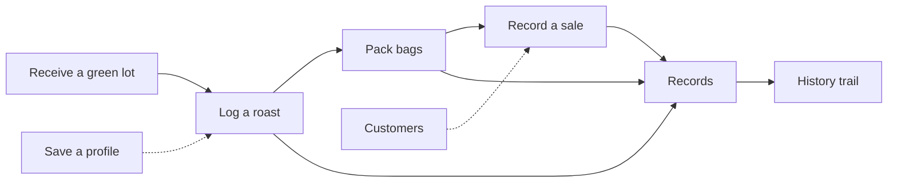
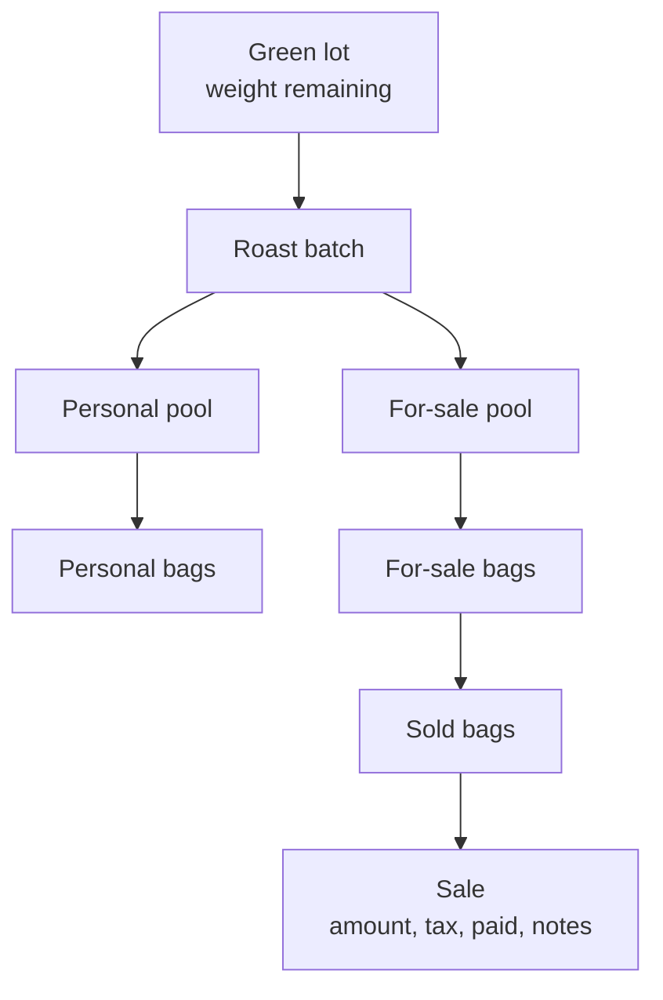
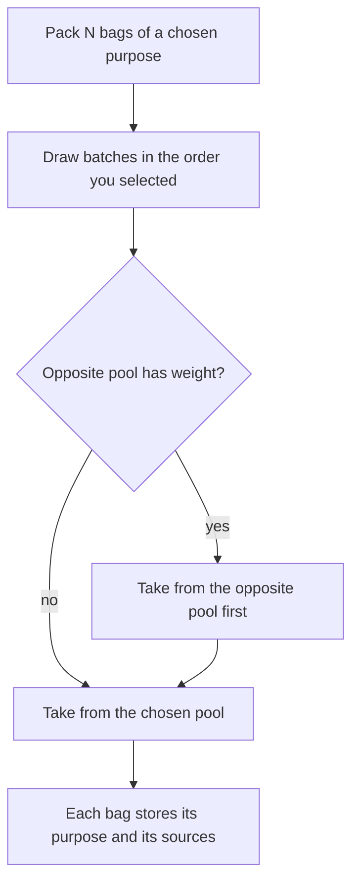
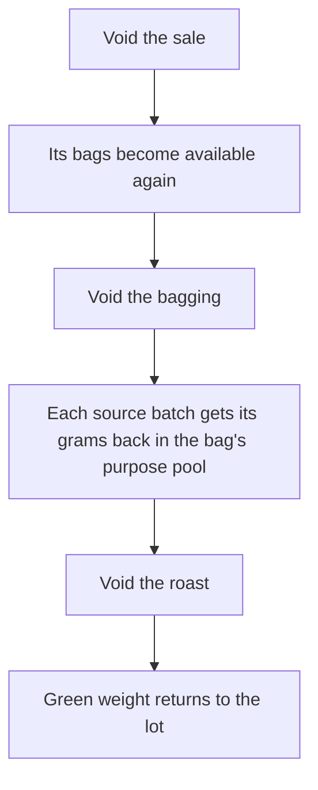
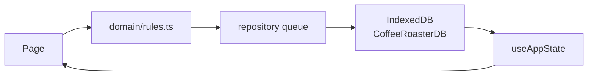

# How inventory moves

CoffeeApp is a local ledger. Nothing is deleted when you correct a mistake. A void marks the record and puts the weight back. Tax is stored if you type it. The app does not calculate or file tax.

Weights are grams. Money is a recorded amount, not a checkout.

## Operator path

Inventory is not in the top bar. Open it from the dashboard green-inventory card. Finished lots stay there after they leave the dashboard list.

## Where weight lives

A roast always has two pools. If you do not set a personal amount, the whole yield is for sale. A personal amount of the whole yield makes the roast internal. Either amount may be zero. A personal amount below zero or above the roasted yield is refused.

## Personal allotment

Each lot has a personal-use reserve. If you leave it blank on receipt, it defaults to the settings target, capped at the weight received. The default target is 1 lb.

The allotment is covered when personal green already charged from that lot is at least the reserve. Charged personal green is the green equivalent of personal roasted weight still in the pool plus personal bags already packed. For-sale roasted weight from a lot is fair to sell only after that lot's allotment is covered. This is a warning on the dashboard. It does not block a roast or a sale.

## Packing

You choose personal use or for sale for the pack. The packed weight is taken from the opposite pool first, then from the chosen pool. Unpacked weight stays in its pool. A pack that exceeds the selected roasts' remaining weight is refused.

One bagging is the set of bags that share an anchor batch and the same `createdAt`. For a pack from several batches, the anchor is the first batch that supplied weight. That pair is how Records groups the bagging. It is not the only source. `sources` on each bag says how many grams came from each batch. Those grams sum to the bag's weight. A single-batch bag omits `sources` and came wholly from its anchor.

Personal bags are not offered for sale. A sale that includes one is refused, and stock does not change.

## Sales and money

A sale records an amount, an optional tax amount, a date, notes, paid or unpaid, and an optional customer. Leaving paid unset stores the sale as paid. Only an explicit unpaid sale counts on the dashboard unpaid card. Leaving the customer unset stores the sale with no customer.

The Records sales list shows paid or unpaid on every sale, shows the linked customer name when there is one, and shows notes when they are not blank.

## Customers

Customers are a directory, not a storefront. Each customer has a name, a grind preference (ground, whole bean, or unknown), optional notes, and the time they were added. There is no contact info, bean preference, or delete.

Status and totals are derived from linked sales that are not void:

- `interested` is no such sale, `bought` is one, `repeat` is two or more.
- Bags bought counts every bag id on those sales. Total spent sums their sale amounts, including unpaid sales. Last purchase is the latest sale date, or blank when there is none.
- A customer with only voided sales is interested, with 0 bags and 0 spent.

Record Sale can pick an existing customer (the option includes the grind) or type a new name. A typed name that already exists, ignoring case, reuses that customer. The form shows the grind and bags bought after a customer is chosen.

The first time the app loads after this directory exists, and again when a backup that has not been linked is imported, unlinked sales are matched from their notes. The note is trimmed, whitespace is collapsed, and a trailing ` - Ground`, ` - Whole`, ` ground`, or ` whole` is removed, longest first, until none remains. That name matches an existing customer or creates one. The grind on a new customer comes from the suffix that was removed. The note itself is not rewritten. Later loads do not scan again, and a sale recorded with no customer after that point stays unlinked.

A separate JSON file can add customers (`coffeeApp customers import v1`). It skips duplicate names and does not replace the directory. It does not run by itself.

Clearing this browser's storage without a backup starts from an empty directory. Customers come back only by restoring a backup that contains them.

P&L uses live sales only:

- Revenue is the sum of sale amounts. Voided sales are left out.
- Cost of goods is the green-lot cost of sold bags that are not void, split by each source batch's share of the bag.
- Gross profit is revenue minus that cost.
- Tax is not part of P&L.

## Corrections

Edits and voids require a note. The record stays. The change log on Records keeps the note and the old and new values.

Void from the outside in. A roast with a live bagging cannot be voided. A bagging that is on a live sale cannot be voided.

A voided record stays in the list, marked with its reason. It does not count toward green weight, roasted weight, bags ready, sales totals, P&L, or the personal allotment.

## Save path

Pages do not write IndexedDB themselves. A change goes through `src/domain/rules.ts`, which returns a new state or an error and leaves the previous state unchanged. `src/data/repository.ts` runs those changes one at a time and, on success, replaces the Dexie tables in one transaction.

Settings can export that state as JSON and replace it with an import. The export is format version 3 and includes customers. Import replaces the current data. It does not merge. A format 2 file restores with an empty customer list, then sale notes are linked once. A format 3 file must include customers. Duplicate names keep the first customer. A sale that points at a customer the file does not contain is restored unlinked.
